# stonebid-web

Frontend do **Stonebid**, casa de leilões online: vitrine pública, lances ao vivo, comprovante compartilhável e histórico de lances auditável por qualquer pessoa.

| Ambiente | Web                                               | API                                                  |
| -------- | ------------------------------------------------- | ---------------------------------------------------- |
| Produção | https://stonebid-web.vercel.app                   | https://stonebid-api-7idhzkkvpq-rj.a.run.app         |
| Staging  | https://stonebid-web-staging.vercel.app           | https://stonebid-api-staging-7idhzkkvpq-rj.a.run.app |
| Código   | https://github.com/FranciscoYlderlan/stonebid-web | https://github.com/FranciscoYlderlan/stonebid-api    |

## Usuários de teste

Senha de todos: `stonebid123`, em produção e em staging (e no seed local).

| Papel     | E-mail                     |
| --------- | -------------------------- |
| Leiloeiro | `leiloeiro@stonebid.dev`   |
| Licitante | `licitante-1@stonebid.dev` |
| Licitante | `licitante-2@stonebid.dev` |

Para ver a disputa ao vivo, abra o mesmo lote com os dois licitantes em janelas diferentes (uma delas anônima).

## Stack

- React 19 + Vite + TypeScript
- Tailwind CSS v4 com shadcn/ui; tema claro e escuro com `next-themes`
- TanStack Router (rotas por arquivo) e TanStack Query
- zod nos formulários, nas respostas da API e nas variáveis de ambiente
- Playwright para os testes de ponta a ponta, com a API simulada

## Como rodar

Requisitos: Node 22.12 ou mais recente (o CI usa Node 26) e uma `stonebid-api` acessível.

```bash
cp .env.example .env
npm install
npm run dev            # http://localhost:5173
```

Por padrão o app chama a API local em `http://localhost:3333` (veja o README da `stonebid-api` para subir a API com Docker e o seed dos usuários de teste). Para apontar para outra API, troque o `VITE_API_URL` no `.env` ou passe na linha de comando:

```bash
VITE_API_URL=https://url-da-api npm run dev
```

O caminho documentado é rodar contra a API local: o `.env.example` da `stonebid-api` já libera `http://localhost:5173` no `CORS_ORIGIN`. Contra a API de staging (`https://stonebid-api-staging-7idhzkkvpq-rj.a.run.app`), só funciona se o `CORS_ORIGIN` de lá aceitar a origem local.

## Variáveis de ambiente

| Variável       | Padrão                  | Para quê                                                                                             |
| -------------- | ----------------------- | ---------------------------------------------------------------------------------------------------- |
| `VITE_API_URL` | `http://localhost:3333` | URL base da API, sem barra no fim. Validada com zod em `src/config/env.ts`: URL inválida para o app. |

No deploy, o `cd.yml` usa as variáveis `VITE_API_URL` (produção) e `VITE_API_URL_STAGING` (staging) do repositório. Nenhum segredo vai para o código.

## Scripts

| Script                            | O que faz                                        |
| --------------------------------- | ------------------------------------------------ |
| `npm run dev`                     | Servidor de desenvolvimento                      |
| `npm run build`                   | Checagem de tipos + build de produção em `dist/` |
| `npm run preview`                 | Serve o build localmente                         |
| `npm run lint`                    | ESLint (sem avisos permitidos)                   |
| `npm run format` / `format:check` | Prettier: formata / confere                      |
| `npm run typecheck`               | TypeScript (`tsc -b`)                            |
| `npm run test:e2e`                | Playwright contra a API simulada (`e2e/`)        |

## Estrutura

- `src/routes/`: rotas por arquivo. `_public` (aberto a todos), `_auth` (só para quem não entrou), `_app` (exige login). O `routeTree.gen.ts` é gerado pelo plugin do router: nunca edite à mão.
- `src/features/<feature>/`: tudo de um domínio (`api`, `components`, `hooks`, `schemas`, `types`), acessado só pelo `index.ts`. Features: `auth`, `lots`, `wallet`, `my-bids`, `receipts`, `audit`.
- `src/components/ui/`: componentes do shadcn/ui, instalados só pela CLI (`npx shadcn@latest add <componente>`).
- `src/components/layout/` e `src/components/common/`: shell da aplicação e componentes próprios reutilizáveis.
- `src/lib/`: cliente HTTP (`api-client.ts`, com o JWT no cabeçalho `Authorization`), hora do servidor e formatação.
- `e2e/`: testes do Playwright; `e2e/support/mock-api.ts` é a API simulada.

## Rotas

| Rota                  | Acesso      | O que mostra                                                                                             |
| --------------------- | ----------- | -------------------------------------------------------------------------------------------------------- |
| `/`                   | Público     | Vitrine: ao vivo, agendados e encerrados (cancelados ficam fora), com contagem pela hora do servidor     |
| `/lots/$id`           | Público     | Sala do lote: lance atual, líder, histórico público de lances e "Dar lance" (leva ao login e volta)      |
| `/lots/$id/audit`     | Público     | Auditoria do lote: veredito ÍNTEGRO ou ADULTERADO, primeira inconsistência e a cadeia de hashes          |
| `/receipts/$id`       | Público     | Comprovante de arremate: valor, data, pseudônimo do vencedor, hash final, copiar link                    |
| `/login`, `/register` | Visitante   | Entrar e criar conta (com o papel: leiloeiro ou licitante)                                               |
| `/bidding/$id`        | Licitante   | Mesma sala com o painel de lance (uma `Idempotency-Key` por lance); leiloeiro vai para `/lots/$id`       |
| `/wallet`             | Licitante   | Saldos total, comprometido e disponível; depósito (uma `Idempotency-Key` por envio) e extrato            |
| `/my-bids`            | Licitante   | Meus arremates: posição em cada lote (liderando, superado, arrematado, perdido, cancelado) e comprovante |
| `/auctioneer`         | Leiloeiro   | Busca no acervo, criação de lote e "Meus lotes" por estado, com total recebido e Cancelar                |
| `/account`            | Quem entrou | Dados da conta                                                                                           |

A sidebar da área logada mostra só os links do papel da conta. Quem abre a tela do outro papel vê um aviso; a proteção real é do servidor.

## Telas

Capturadas com a API simulada dos testes (`e2e/support/mock-api.ts`): dados fictícios e imagens abstratas no lugar das obras.

### Vitrine — `/`

Lotes ao vivo, agendados e encerrados, com a contagem de cada um.

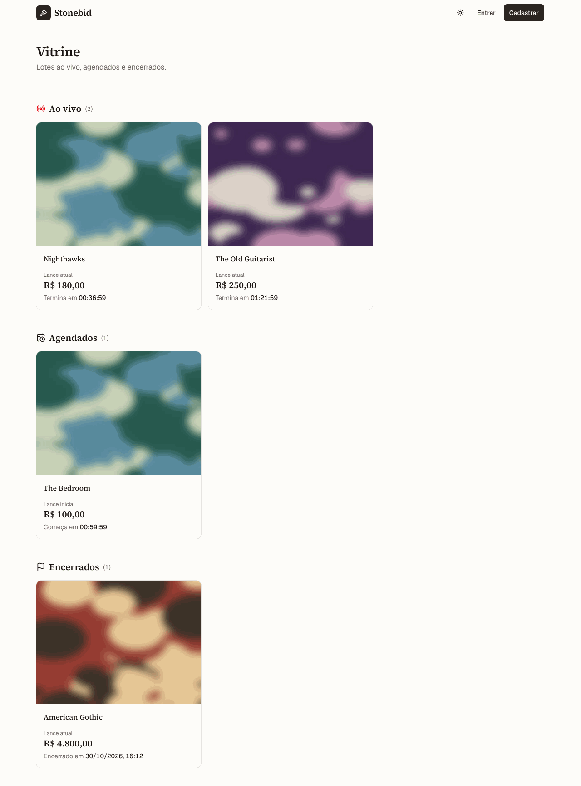

### Painel do leiloeiro: busca — `/auctioneer`

Busca no acervo do Art Institute of Chicago; obra já vendida aparece com o selo e sem "Criar lote".

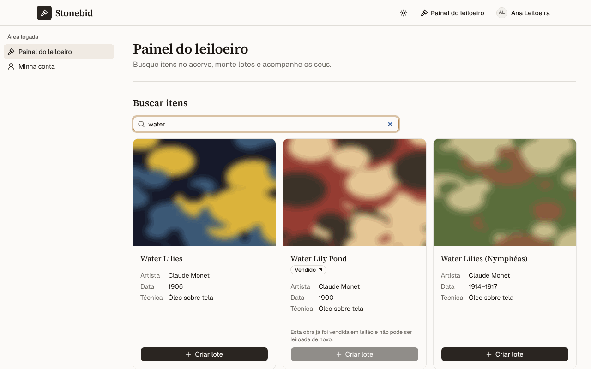

### Painel do leiloeiro: criação de lote — `/auctioneer`

Lance inicial, incremento mínimo, início e fim do lote a partir da obra escolhida.

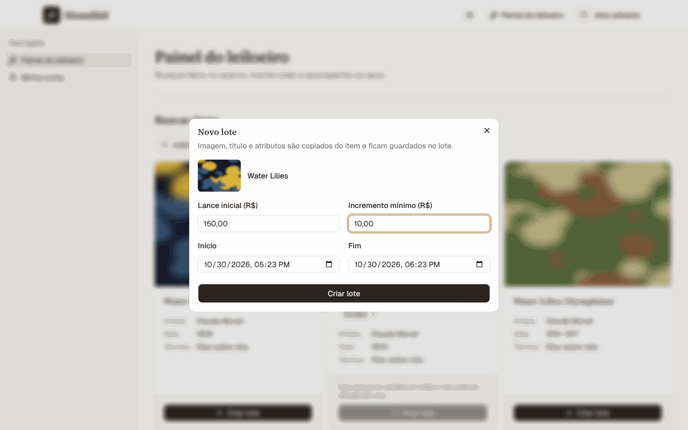

### Painel do leiloeiro: resultados — `/auctioneer`

"Meus lotes" por estado, com o total recebido e o resultado do lote encerrado (valor, vencedor e comprovante).

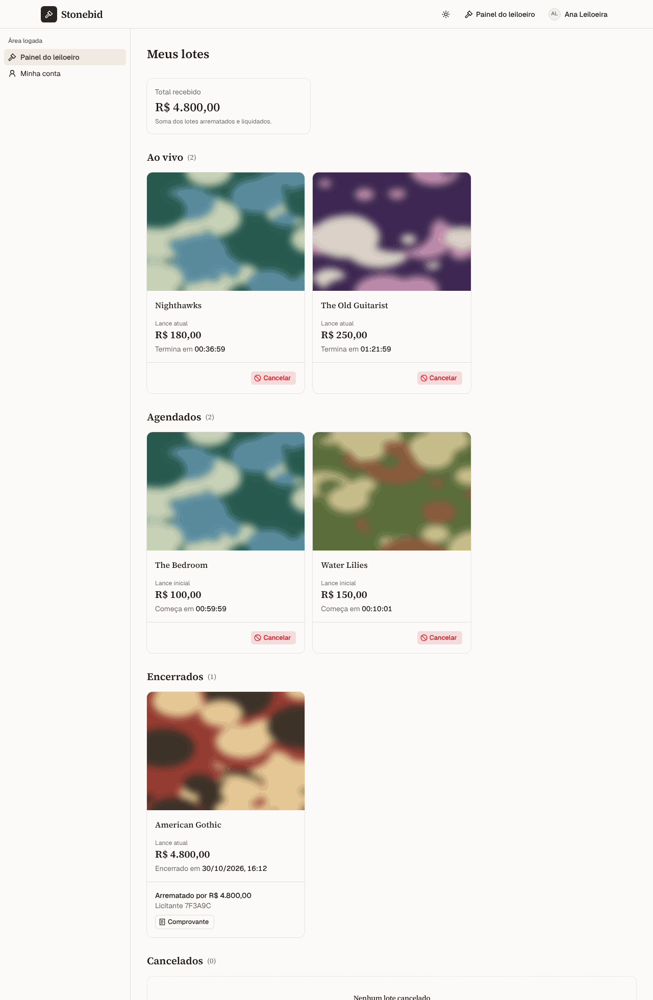

### Sala do lote ao vivo — `/bidding/$id`

Lance atual, líder, contagem, painel de lance com o mínimo e histórico público de lances.

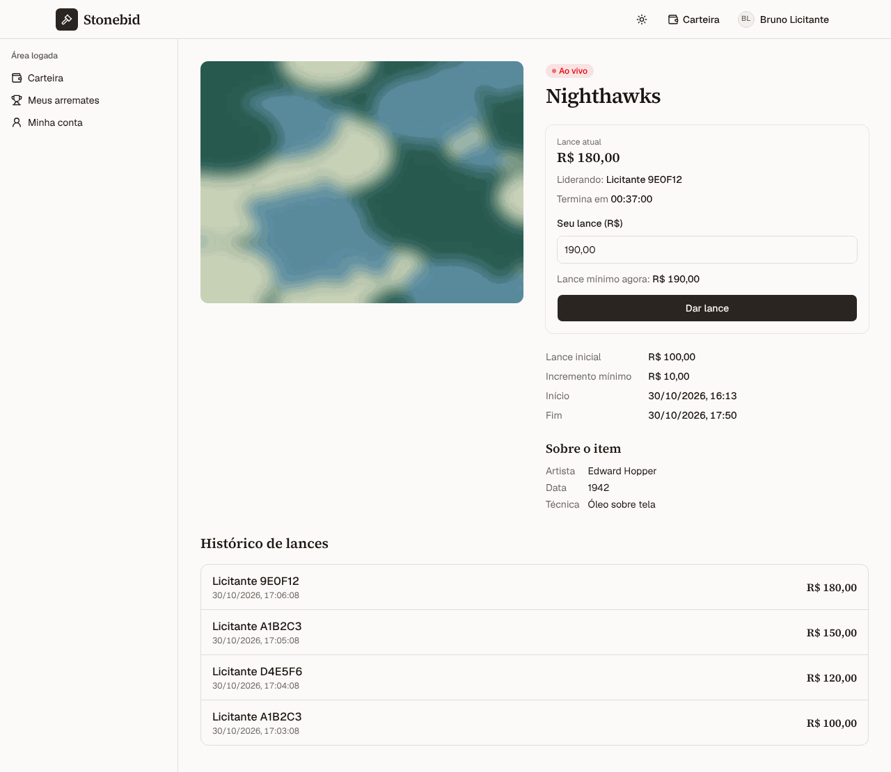

### Lance recusado — `/bidding/$id`

A recusa chega com a mensagem da API (aqui, lance abaixo do mínimo) e o campo volta para o mínimo.

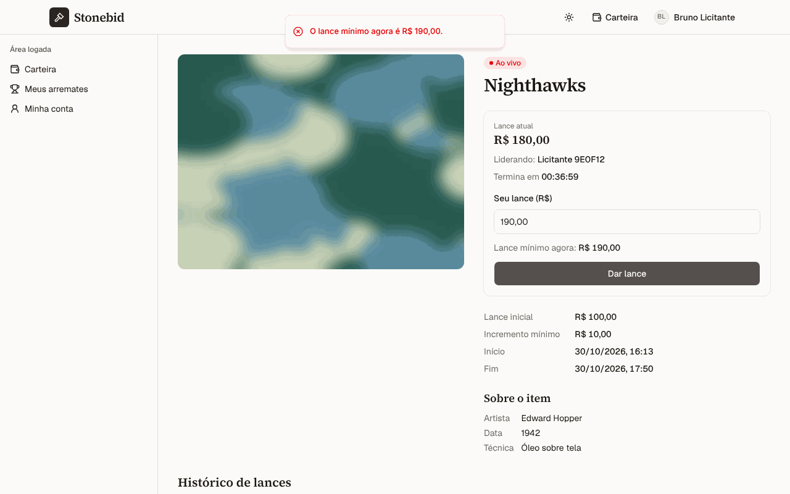

### Carteira — `/wallet`

Saldos disponível, comprometido e total; depósito simulado e extrato com link para o lote.

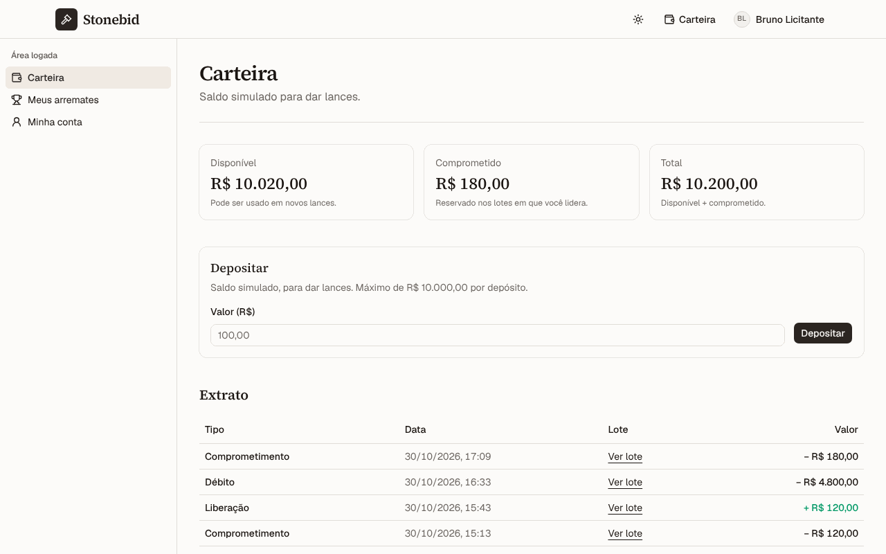

### Meus arremates — `/my-bids`

Posição do licitante em cada lote e o botão do comprovante no lote arrematado.

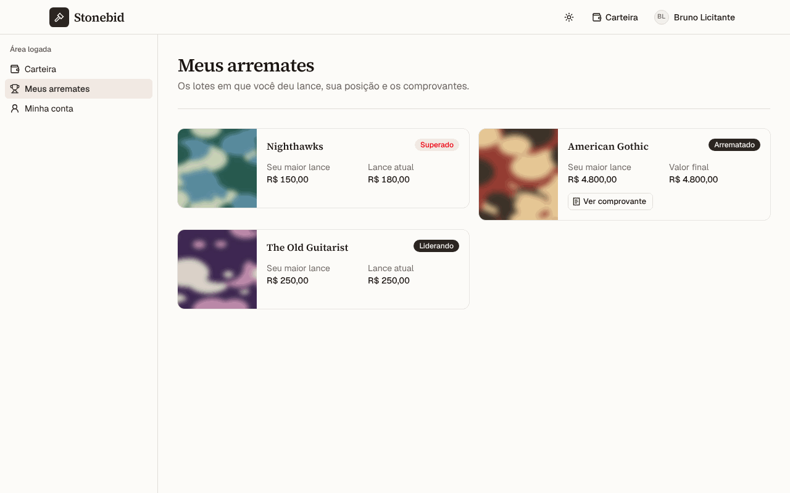

### Comprovante — `/receipts/$id`

Página pública: valor final, data e hora, pseudônimo do vencedor e hash final, com copiar link e o caminho para a auditoria.

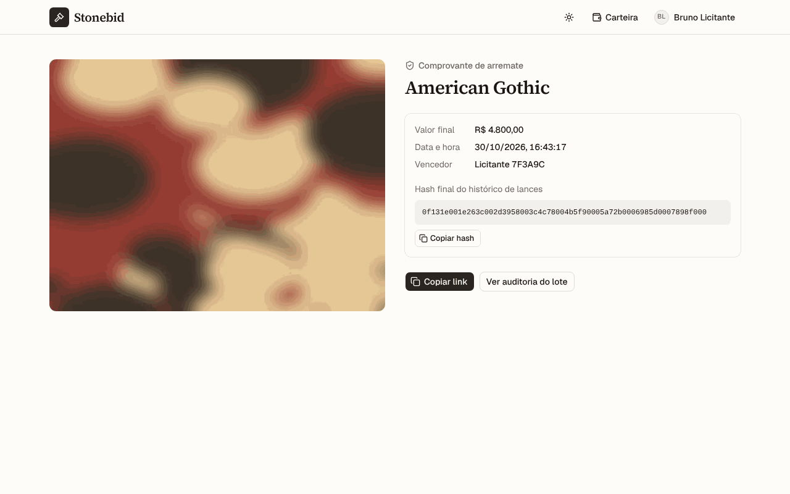

### Auditoria: ÍNTEGRO — `/lots/$id/audit`

Página pública: veredito recalculado a cada acesso e a cadeia completa de lances com os hashes.

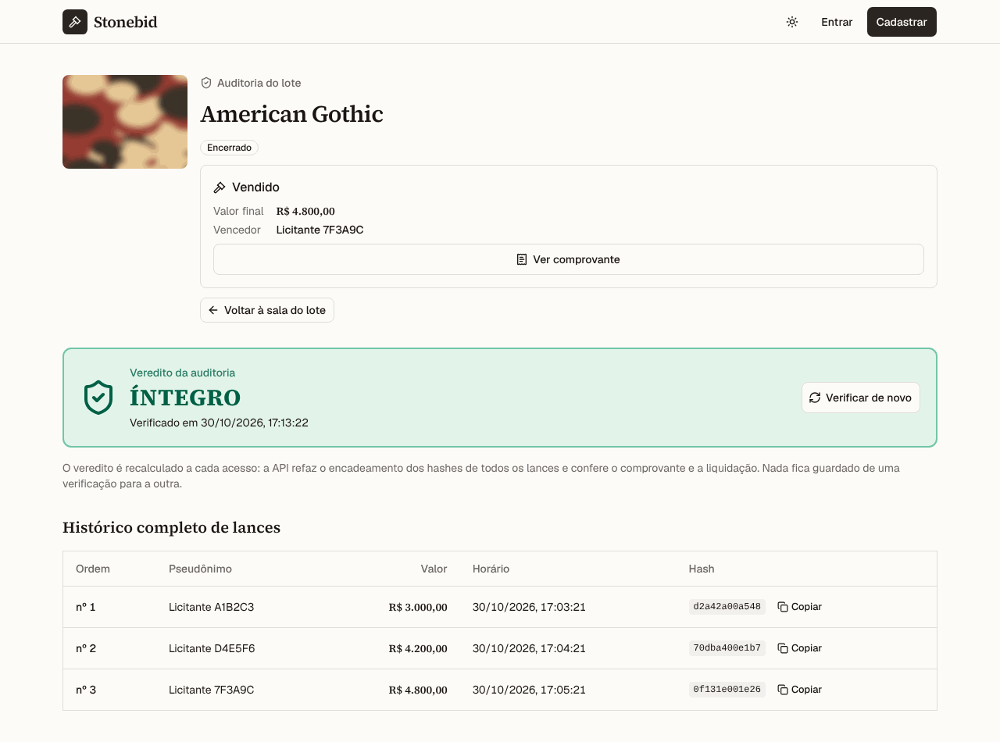

### Auditoria: ADULTERADO — `/lots/$id/audit`

O primeiro registro inconsistente aparece com o motivo e a linha destacada.

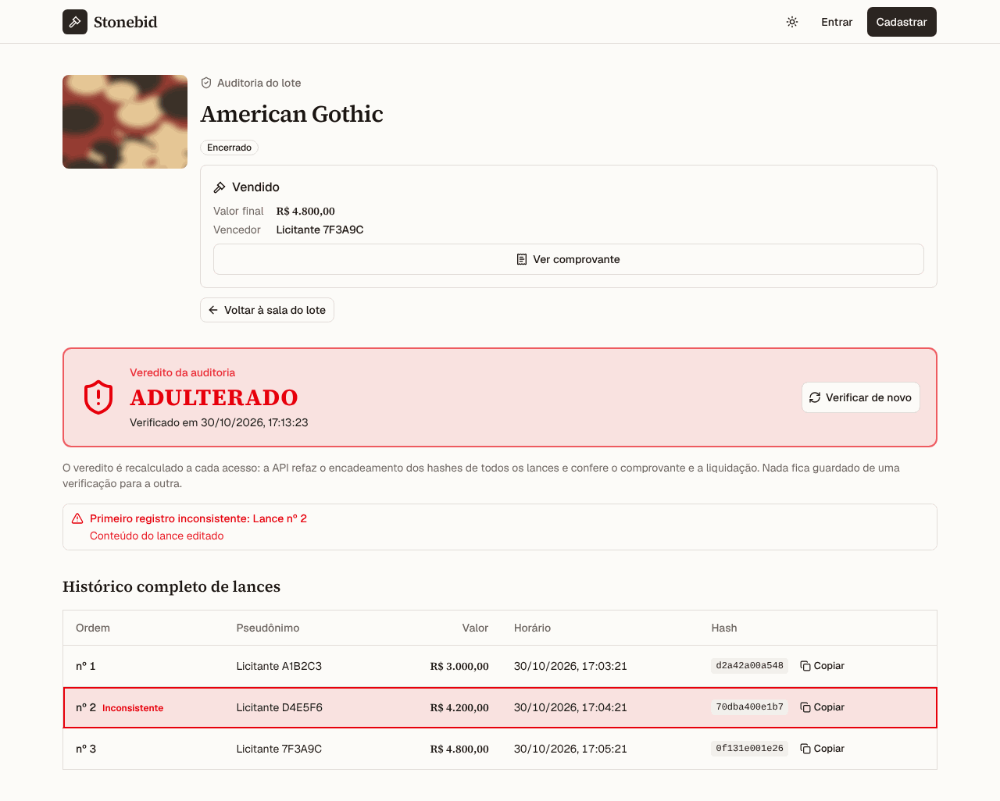

### Tema escuro — `/`

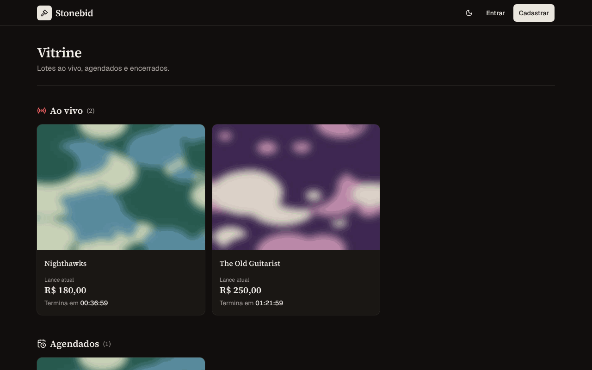

### Celular (390 px) — `/bidding/$id`

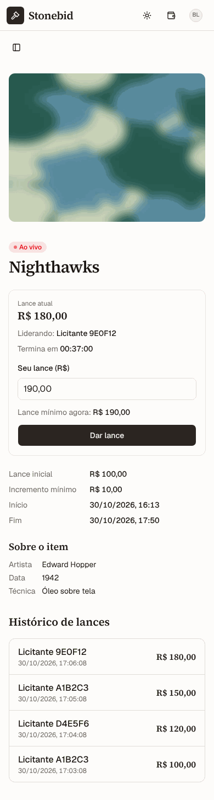

## Características de funcionamento e limites

Escolhas de projeto da interface, cada uma com o motivo. Várias seguem regras da `stonebid-api`, que é quem decide.

- **Tempo real por SSE:** a sala do lote assina `GET /lots/:id/events` (`EventSource`), o canal de tempo real da API. Cada evento (lance, cancelamento, liquidação) traz o lote inteiro, então a sala se atualiza sem outra consulta ao lote, e recarrega o histórico.
- **Recarga enquanto o stream está fora:** a sala recarrega o lote e o histórico a cada 3 s, para seguir atualizada sem o stream. O navegador reconecta sozinho; se ele desistir (erro HTTP na reconexão, como um 503 durante um deploy), a sala abre outro stream depois de 5 s. Lote encerrado e liquidado, ou cancelado, não muda mais, e a sala fecha o stream.
- **Viradas de estado pela hora:** a API calcula o estado do lote pelo relógio do servidor, sem evento na virada de agendado para ao vivo nem de ao vivo para encerrado. Por isso a sala relê o lote no instante da virada; encerrado e ainda não liquidado, relê a cada 5 s até aparecer o resultado.
- **Relógio do servidor:** contagens e o fechamento do painel de lance usam a hora do servidor (diferença calculada a cada resposta), não o relógio do computador, porque é o servidor que decide se um lance ainda entra. Com a contagem zerada e o servidor ainda sem encerrar, o painel fica desabilitado.
- **Vitrine e Meus arremates se atualizam a cada 15 s:** os lotes mudam de estado com o tempo, e a posição muda com os lances dos outros e com a liquidação. O stream da API é por lote, então essas listas usam recarga periódica.
- **Lance e depósito sem duplicar:** cada envio leva uma `Idempotency-Key`. Depois de uma falha (ex.: a rede caiu com o lance já gravado), a nova tentativa do mesmo valor reusa a chave e a API não grava de novo. O botão trava enquanto a requisição está no ar.
- **Recusas com a mensagem da API:** lance abaixo do mínimo, saldo insuficiente, quem já lidera, lote não iniciado, encerrado ou cancelado aparecem com a mensagem que a API devolve, em português, porque as regras do lance moram no servidor. Abaixo do mínimo, o campo passa a sugerir o mínimo informado.
- **Sessão:** o JWT fica no `localStorage` e vai no cabeçalho `Authorization`, o formato de sessão da API. Um 401 em qualquer chamada autenticada significa que o token não vale mais: o app apaga o token e a pessoa segue como visitante. Se a checagem da sessão falhar por outro motivo (rede, 5xx), o app mostra um aviso e segue, sem apagar o token.
- **Papel:** licitante e leiloeiro veem só os links do próprio papel, e o leiloeiro que abre `/bidding/$id` vai para `/lots/$id`, já que leiloeiro não dá lance. A tela organiza a navegação; a regra vale no servidor.
- **Imagem da obra:** se a imagem falta ou não carrega, a capa mostra um marcador no lugar, na mesma proporção.
- **Staging dorme:** a API de staging roda com zero instâncias mínimas no Cloud Run, então a primeira chamada depois de um tempo parado pode levar alguns segundos.

## Testes de ponta a ponta

Playwright em `e2e/`, com a API simulada em memória (`e2e/support/mock-api.ts`): toda chamada para `VITE_API_URL` é interceptada, inclusive o stream SSE (um `EventSource` simulado), então os testes não dependem da `stonebid-api` nem da internet. O `playwright.config.ts` sobe o `vite` sozinho na porta 4173.

```bash
npx playwright install chromium   # uma vez
npm run test:e2e
```

## CI/CD

```
branch → PR → CI verde → merge em staging → deploy de staging → merge em main → deploy de produção
```

- **CI** (`.github/workflows/ci.yml`), em todo push e PR: lint, formatação, tipos e build; e o Playwright com a API simulada.
- **CD** (`.github/workflows/cd.yml`): roda só depois do CI verde num push em `staging` ou `main`. `staging` publica um preview na Vercel e aponta o alias fixo `stonebid-web-staging.vercel.app`; `main` publica em produção.
- O deploy automático pelo Git da Vercel fica desligado (`vercel.json`): o único caminho para o ar é o `cd.yml`. O `vercel.json` também reescreve todas as rotas para `index.html` (SPA).

## Uso de IA

Como usei IA neste projeto (orquestração de subagentes, memória no Obsidian e quem definiu, aplicou e refinou cada parte): [docs/uso-de-ia.md](docs/uso-de-ia.md).
