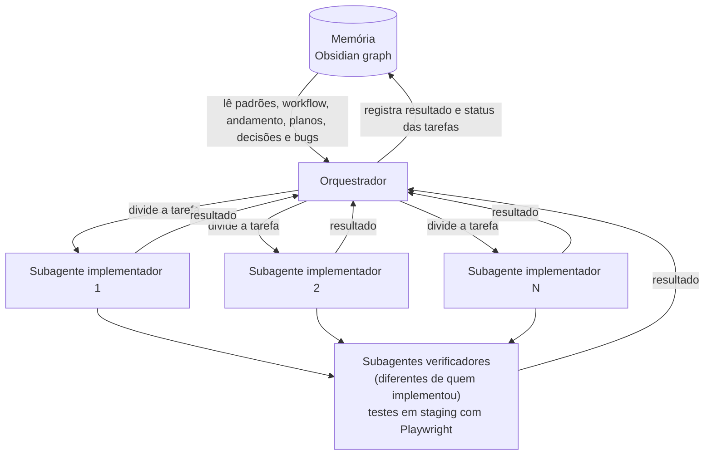

# Uso de IA no Stonebid

Este relato conta onde e como usei IA no desenvolvimento do Stonebid (`stonebid-web` e `stonebid-api`) e o que ficou com cada parte: o que eu defini, o que a IA aplicou e quem refinou.

## Por que trabalhei assim

Tomei o projeto como um desafio pessoal: aplicar, pela primeira vez, técnicas que a comunidade adotou há pouco, para ganhar conhecimento de causa sobre elas.

Montei um harness próprio para orquestrar subagentes. Com ele eu gerencio os modelos, as ações e a quantidade de subagentes, com pontos de benchmarking.

## Como o trabalho se organiza

Usei agentes em várias threads e graph engineering, no espírito de "dividir para conquistar": o problema vira problemas menores, resolvidos em paralelo.

- O **orquestrador** gerencia o trabalho e escreve na memória.
- Os **subagentes** desenvolvem e testam com Playwright. Quem cria não é quem testa: quem verifica é outro subagente, e, por padrão, ao fim, os testes rodam em staging.
- A **memória** é um cofre do Obsidian. Uso o MCP do Obsidian para que a máquina Linux use a Obsidian CLI. O trabalho é spec-driven: a especificação mora na memória e é lida pela CLI, o que gasta menos contexto, já que o código nem sempre deixa explícitos os padrões e a estrutura.

O orquestrador acessa a memória, divide a tarefa entre vários subagentes em paralelo, recebe de volta o resultado de cada um e registra na memória o resultado e o status das tarefas.

## O que a memória guarda

- **Padrões** do projeto.
- **Workflow:** o fluxo de trabalho, com as etapas, quem faz o quê e como orquestrador e subagentes trabalham, do plano ao teste em staging.
- **Andamento:** o roteiro com as etapas e o status de cada uma, e o "onde parei" de cada sessão, nos diários.
- **Planos:** as sugestões da IA.
- **Decisões:** o que eu escolhi.
- **Bugs:** um bug recorrente fica no histórico com o que ocorreu, por quê, as suposições e como foi resolvido, para não voltar.

## Corrigir a causa, não o sintoma

Para mim, o código é sintoma de um processo mal estruturado ou ambíguo. Por isso o harness guarda os padrões e as decisões históricas: o objetivo é o mínimo de erro e de código fora do padrão.

## Quem fez o quê

Legenda: 🧠 = IA · 👤 = desenvolvedor.

| Tópico                             | Definiu | Aplicou | Refinou |
| ---------------------------------- | ------- | ------- | ------- |
| Definição dos requisitos           | 👤      | 🧠      | 🧠      |
| Modelagem da estrutura do Obsidian | 👤      | 👤 🧠   | 👤 🧠   |
| Modelagem do harness               | 👤      | 🧠      | 👤      |
| Tecnologias do frontend            | 👤      | 🧠      | 👤      |
| Tecnologias do backend             | 👤      | 🧠      | 👤      |
| Padrões e arquitetura do frontend  | 👤      | 🧠      | 👤      |
| Padrões e arquitetura do backend   | 👤      | 🧠      | 👤      |
| Configuração no GCP                | 👤      | 🧠 👤   | 🧠      |
| Escrita de código                  | 👤      | 🧠      | 👤      |
| Testes                             | 🧠      | 🧠      | 🧠      |

## Pontos a aprimorar e agradecimento

Foi a primeira vez que usei essas técnicas, então há pontos a aprimorar. Gostei do resultado e aprendi muito no processo. Agradeço a oportunidade deste teste técnico.
